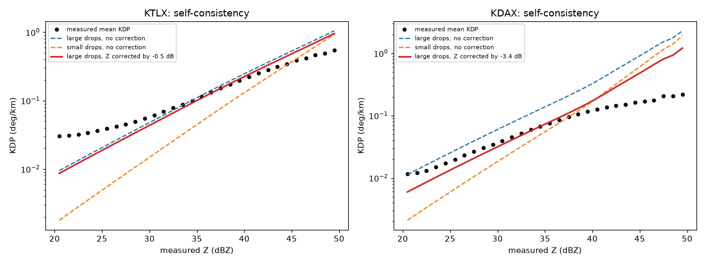

# radarwow-calibration

**radar-wow stage 1: Calibration.** Absolute Z calibration and ZDR bias.

Part of [radar-wow](https://github.com/manmeet3591/radar-wow), a set of repos that together build a radar QPE system that works for S, C and X band radars.
Every algorithm is one class implementing one paper, with the same interface: it takes an xradar sweep or volume with canonical moment names, declares the bands and moments it needs, and records provenance.

## Sub-components

| sub-component | algorithm | source | DOI | status |
|---|---|---|---|---|
| Z: spaceborne radar matching | `Warren2018GPMMatch` | Warren et al. 2018, JTECH | [doi:10.1175/JTECH-D-17-0128.1](https://doi.org/10.1175/JTECH-D-17-0128.1) | planned |
| Z: relative calibration adjustment + GPM | `Crisologo2018` | Crisologo et al. 2018, AMT | [doi:10.5194/amt-11-5223-2018](https://doi.org/10.5194/amt-11-5223-2018) | planned |
| ZDR: dry snow above the melting layer, light rain | `zdr_offset_snow`, `zdr_offset_light_rain` | Ryzhkov et al. 2005, JTECH | [doi:10.1175/JTECH1772.1](https://doi.org/10.1175/JTECH1772.1) | implemented + notebook |
| Z: self-consistency Z-ZDR-KDP (S band) | `rain_bins`, `self_consistency_z_bias` | Ryzhkov et al. 2005, JTECH | [doi:10.1175/JTECH1772.1](https://doi.org/10.1175/JTECH1772.1) | implemented + notebook |
| Z: radar-to-radar in overlap areas | `radarwow.mosaic.overlap_difference` | see radarwow-mosaic |  | implemented + notebook |

## Install

```bash
pip install git+https://github.com/manmeet3591/radarwow-core git+https://github.com/manmeet3591/radarwow-calibration
```

## Notebooks (free data, S / C / X band)

- [`notebooks/01_natural_target_calibration.ipynb`](notebooks/01_natural_target_calibration.ipynb): open in Colab via `https://colab.research.google.com/github/manmeet3591/radarwow-calibration/blob/main/notebooks/01_natural_target_calibration.ipynb`

## Results



## Usage

```python
from radarwow.core import load_sample
from radarwow.calibration import *  # see table above

vol = load_sample('arm_csapr2_c')        # or open_volume('my_file')
# out = SomeAlgorithm()(vol)            # band read from the file, or band='S'|'C'|'X'
```

## Status legend

*implemented + notebook*: code, tests, executed notebook. *planned*: interface fixed, code to write. *stub*: class exists, raises `NotImplementedError`. *to review*: paper to read before deciding.

## License

MIT. Data used in the notebooks comes from public archives (NEXRAD on AWS, ARM, IMD via open-radar-data) under their own terms.
